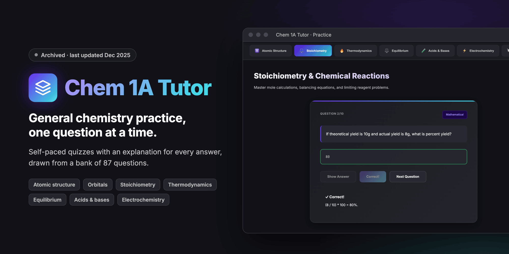
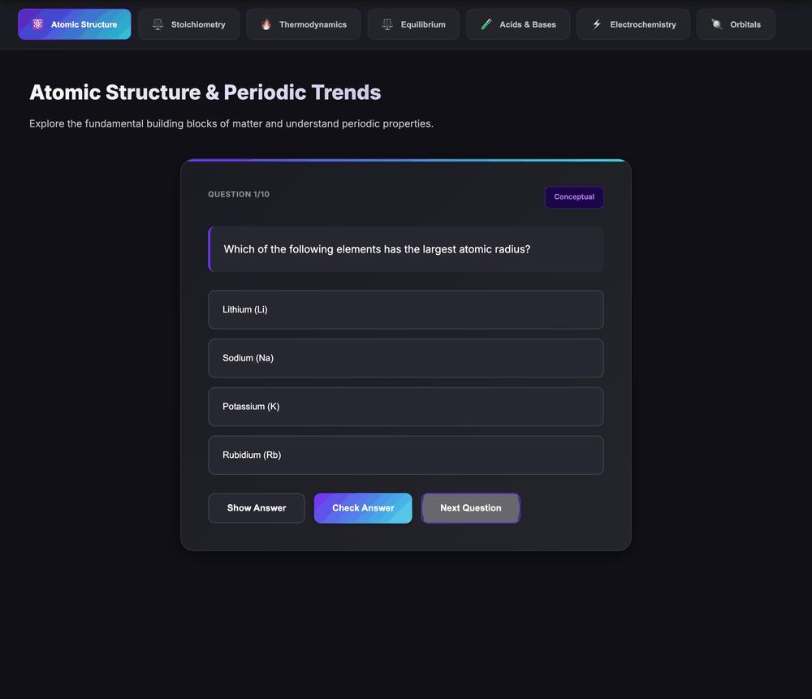
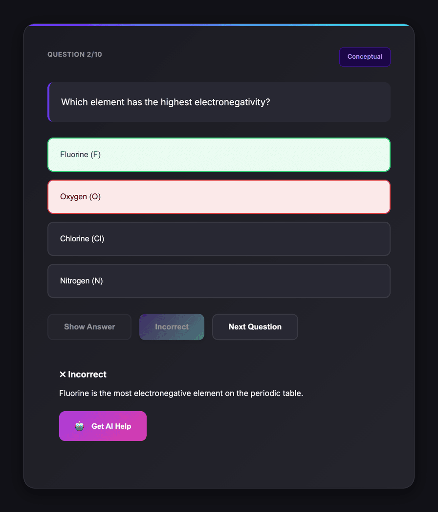
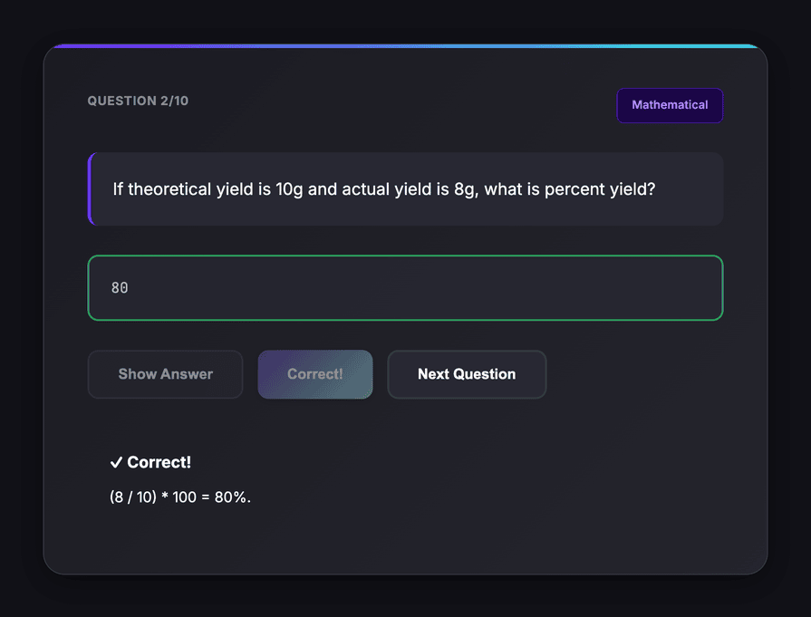
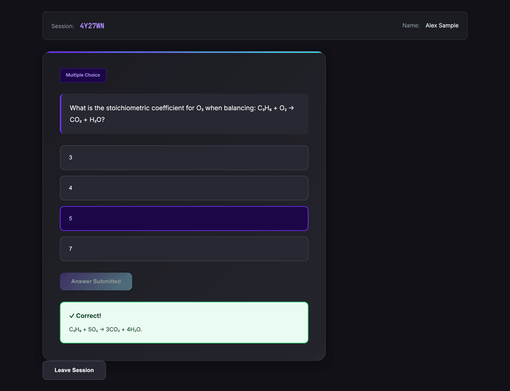
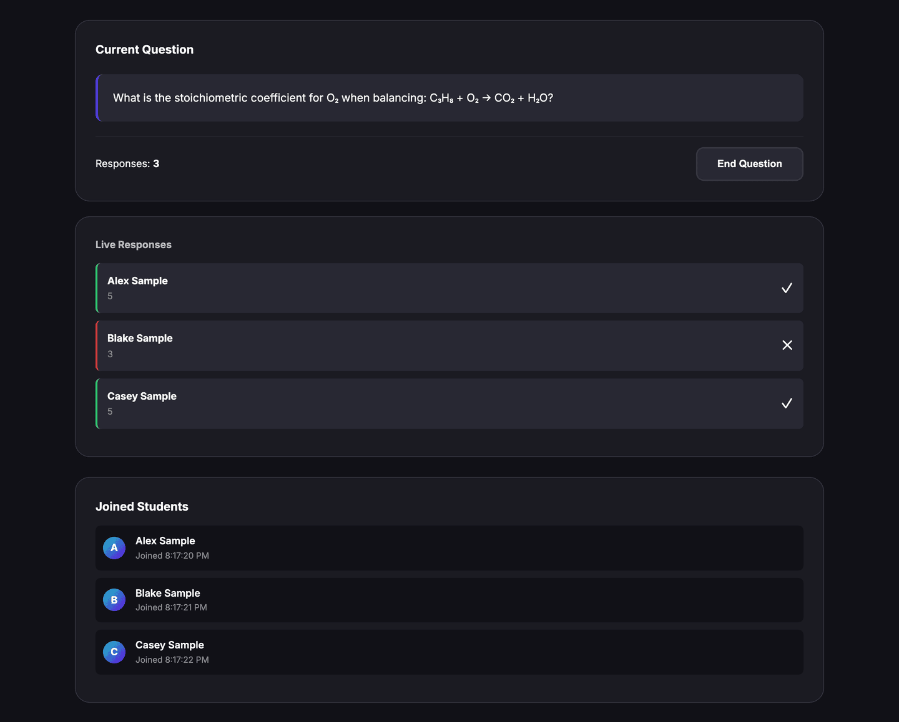
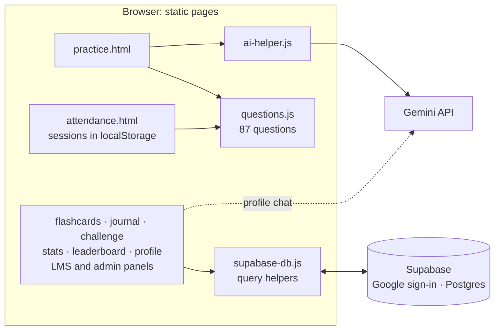

<p align="center">
  
</p>

<p align="center">
  <b>A browser-based practice site for general chemistry (Chem 1A).</b><br>
  Students answer randomized questions and get an explanation for every answer. An Attendance mode lets an instructor broadcast questions from the same bank.
</p>

<p align="center">
  
  
  
  
  
  
  
</p>

<p align="center">
  <a href="#see-it-work">Demo</a> ·
  <a href="#how-it-works">How it works</a> ·
  <a href="#features">Features</a> ·
  <a href="#architecture">Architecture</a> ·
  <a href="#run-it">Run it</a> ·
  <a href="#known-limitations">Limitations</a>
</p>

> [!NOTE]
> This project is archived. It was built from December 9 to 13, 2025, and is no longer maintained. Practice runs with no backend, and Attendance needs only a Google sign-in for students. The other pages need a Supabase project, and part of that database schema is not in this repo. See [Known limitations](#known-limitations).

## Why

A wrong answer on a problem set tells you that you missed it, not why. Chem 1A Tutor attaches a written explanation to every question, so each answer, right or wrong, ends with the reasoning. It covers seven general chemistry topics, from atomic structure to electrochemistry. An Attendance mode prototypes live class questions from the same bank.

## See it work

<p align="center">
  
</p>

<sub>Recorded from the committed code running locally in headless Chromium, with every request to Supabase and Gemini blocked. The questions and explanations come from <code>questions.js</code>. The site header is cropped out.</sub>

## How it works

<table>
  <tr>
    <td width="50%"></td>
    <td width="50%"></td>
  </tr>
  <tr>
    <td valign="top"><b>1. Pick a topic and answer.</b> Each session draws 10 random questions from that topic's pool. After you check an answer, the right choice turns green and the explanation appears. A wrong answer also shows <b>Get AI Help</b>, which asks Gemini why your specific choice was wrong.</td>
    <td valign="top"><b>2. Type numeric answers.</b> Questions marked <i>Mathematical</i> take a typed answer. A number counts as correct within that question's tolerance, and the worked calculation appears after you check.</td>
  </tr>
  <tr>
    <td width="50%"></td>
    <td width="50%"></td>
  </tr>
  <tr>
    <td valign="top"><b>3. Students join a session with a code.</b> The instructor creates a session with a 6-character code and broadcasts a question from the bank. Each student signs in with Google, enters the code, answers, and sees the explanation right away.</td>
    <td valign="top"><b>4. The instructor sees every response.</b> Answers appear as they arrive, marked right or wrong, next to the list of students who joined. <b>Download Attendance</b> exports the session as a CSV file.</td>
  </tr>
</table>

<sub>All four screenshots come from the committed code with no backend. The students (Alex, Blake, and Casey Sample) are sample accounts written into a throwaway browser profile in place of a Google sign-in.</sub>

## Features

| Page | What it does | Needs |
|---|---|---|
| Practice (`practice.html`) | 87 questions in 7 topics (47 multiple-choice, 40 typed), 10 per session, **Show Answer**, and AI help with follow-up questions | Nothing. AI help needs a Gemini API key. |
| Attendance (`attendance.html`) | Instructor sessions, broadcast questions, live responses, CSV export, and a shared PDF slideshow with ink annotations | Google sign-in for students. Syncs only within one browser. |
| Flashcards (`flashcards.html`) | Spaced-repetition review rated **Again**, **Hard**, **Good**, or **Easy**, scheduled with the SM-2 algorithm (1 day, then 6 days, then the last interval times an ease factor) | Supabase |
| Journal (`mistakes.html`) | Missed questions with your answer, the correct one, your notes, and a reviewed flag | Supabase |
| Challenge (`challenges.html`) | One question per day: 50 points for a right answer, 5 for trying | Supabase |
| Stats and Leaderboard (`analytics.html`, `leaderboard.html`) | Topic radar chart, activity chart, streaks, and a points ranking | Supabase |
| Profile (`profile.html`) | Quiz history and an AI chemistry chat | Sign-in. History falls back to the browser when Supabase is unavailable. The chat needs Gemini. |
| LMS and admin panels (`lms.html`, `class-detail.html`, `owner.html`, `dev.html`) | Owner, admin, teacher, and student roles; schools, classes, and invite links; session history; and switches that hide pages | Supabase |

## Design decisions

- **No build step.** Every page is static HTML, CSS, and plain JavaScript, with libraries loaded from CDNs. On Vercel, `build.sh` only writes `gemini-config.js` from the `GEMINI_API_KEY` environment variable.
- **Explanations ship with the questions.** Each of the 87 questions in `questions.js` carries its own explanation, so feedback needs no network call. AI help is extra: the prompt sends the topic, the question, the correct answer, and the student's answer, and asks for two or three sentences on the concept they missed.
- **Tolerance for numbers, exact match for words.** Typed answers with a tolerance are compared as numbers. Other typed answers must match exactly, ignoring case.
- **Sessions without a server.** Attendance stores the active session in `localStorage`, and each tab polls it every 2 seconds. A comment in `attendance.js` calls this a demonstration and suggests WebSockets or Firebase for real use.

## Architecture



| Path | What it holds |
|---|---|
| `index.html` | Home page with the mode cards and Google sign-in |
| `practice.html`, `practice.js` | Topic practice, grading, local stats, and AI help |
| `questions.js` | The question bank, each question with its explanation |
| `attendance.html`, `attendance.js`, `slideshow.js` | Live sessions, broadcast questions, and the PDF slideshow |
| `flashcards.html`, `mistakes.html`, `challenges.html`, `analytics.html`, `leaderboard.html` | Learning features stored in Supabase |
| `profile.html`, `profile.js` | Quiz history and the AI chat |
| `lms.html`, `lms.js`, `class-detail.*`, `owner.*`, `dev.*`, `roles.js` | Roles, schools, classes, invites, and admin switches |
| `supabase-db.js` | Supabase queries for every table |
| `ai-helper.js` | The Gemini prompt for wrong-answer explanations |
| `supabase-migration-fixed.sql`, `advanced-features-migration.sql` | Schema for invites and the learning-feature tables |
| `migrate-to-supabase.js` | One-time copy of older `localStorage` data into Supabase |
| `build.sh`, `vercel.json` | Vercel static deploy |
| `styles.css` | The shared dark theme |

## Run it

To try Practice, serve the folder and open it. You need Python 3.

```sh
python3 -m http.server 8000
```

Open `http://localhost:8000` and choose **Practice**.

To try Attendance, open `attendance.html` in two tabs of the same browser: log in as the instructor in one and join as a student in the other. Students sign in with Google first. That flow uses the OAuth client ID in `attendance.js`, which accepts only the origins registered for it. To use your own client, follow [`google-oauth-guide.md`](google-oauth-guide.md) and replace `GOOGLE_CLIENT_ID`.

To run the pages that store data, you also need a Supabase project:

1. In Supabase, enable the Google sign-in provider.
2. In the Supabase SQL editor, run `supabase-migration-fixed.sql` and `advanced-features-migration.sql`.
3. Copy `supabase-config.example.js` to `supabase-config.js`, and add your project URL and anon key. `index.html`, `profile.html`, `lms.html`, `class-detail.html`, `owner.html`, and `dev.html` set the URL and key inline, so update those too.
4. **Optional:** For AI help, copy `gemini-config.example.js` to `gemini-config.js` and add your Gemini API key. On Vercel, set `GEMINI_API_KEY` instead.

The home page signs in through Supabase's Google provider. Attendance and Practice still use the direct Google OAuth flow from `google-oauth-guide.md`.

## Known limitations

- **Attendance works in one browser only.** Sessions and shared slides live in `localStorage`, so the instructor and students must use tabs in the same browser on the same computer. Large PDFs don't fit in `localStorage` and fail to share.
- **Access checks run in the browser.** The instructor password and the owner account are hardcoded in client-side JavaScript. Treat roles as interface gating, not security.
- **The Gemini key is public by design.** AI help calls the Gemini API from the browser, so anyone who loads the site can read the key in `gemini-config.js`.
- **An unpinned CDN script breaks several pages.** The pages load `@supabase/supabase-js@2` with no exact version. The current 2.x build (2.118.0 in October 2026) declares a global `supabase` that clashes with each page's own `supabase` variable, so scripts on the home, flashcards, challenge, stats, journal, and profile pages stop with `Identifier 'supabase' has already been declared`. With 2.86.0, those pages load without that error.
- **Practice results don't reach Supabase.** `practice.html` loads `supabase-db.js` but not the Supabase client, so finished quizzes don't update flashcards, the journal, streaks, or the leaderboard.
- **Part of the schema is missing.** The SQL files don't create the `schools`, `classes`, `class_students`, `class_teachers`, `user_roles`, `quiz_attempts`, or `app_settings` tables that the code queries.
- **Small daily-challenge pool.** The challenge picks from 3 hardcoded questions.
- **Dashboard quirks.** The **Students Joined** counter stays at 0 because two elements share its ID, and **Enter Slideshow** calls a function that doesn't exist. **Toggle Slideshow** opens the slideshow.
- No automated tests.

## Credits

Built by Noel Sason.
